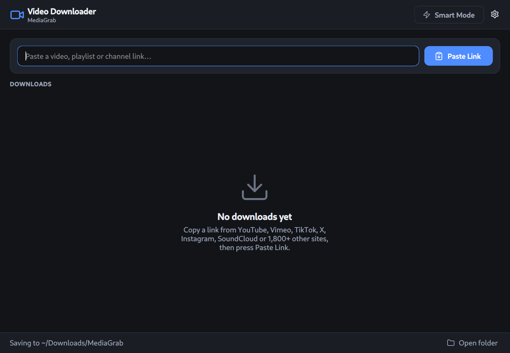
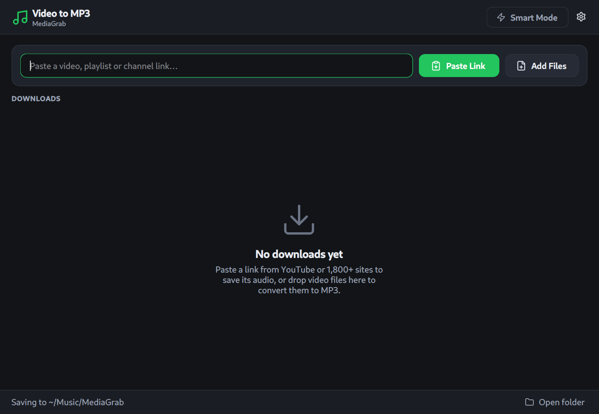

# MediaGrab

A desktop suite for Linux that saves video and audio from YouTube and 1,800+ other sites,
built on [yt-dlp](https://github.com/yt-dlp/yt-dlp) with a PySide6 (Qt) interface.
It ships as two apps that share one codebase:

| **Video Downloader** | **Video to MP3** |
|---|---|
|  |  |
| Video up to 8K in MP4 or MKV, or audio only | Audio in MP3, M4A, OGG, OPUS, FLAC or WAV |
| Whole playlists and channels: pick the items, saved in a subfolder | Cover art and title/artist tags embedded |
| Subtitles saved as `.srt` | Converts local video files: **Add Files** or drag and drop |

## Features (both apps)

- **Paste Link** button, or Ctrl+V, or type a link and press Enter.
- An options dialog that shows the estimated file size of every quality.
- **Smart Mode** skips the dialog and reuses your last choices.
- Parallel downloads (3 by default).
- **Pause and resume**: a paused download continues where it stopped.
- Download history is kept between sessions.
- Dark interface: blue accent for video, green for audio.

## Requirements

- Linux with a desktop environment (tested on Kali/Debian with XFCE)
- Python 3 with venv (tested with 3.14)
- `ffmpeg` (merging video and audio, conversion)
- `nodejs` (YouTube needs a JavaScript runtime)

```sh
sudo apt install python3 python3-venv ffmpeg nodejs
```

## Install

```sh
git clone https://github.com/RodrigoCossi/MediaGrab.git
cd MediaGrab
./install.sh
```

The installer creates a private virtual environment in `.venv/` (it uses `uv` when available, otherwise
`pip`), installs the dependencies, and adds both apps to the application menu and the desktop.
Nothing is installed system-wide.

Run it from the menu, the desktop icons, or a terminal:

```sh
bin/mediagrab-video   # Video Downloader
bin/mediagrab-mp3     # Video to MP3
```

**Keep yt-dlp up to date.** Sites change often and old versions stop working. Run `./install.sh`
again any time to update.

## Signing in (YouTube on servers, Vimeo, private videos)

Some sites refuse anonymous downloads; YouTube does so from datacenter IP addresses
("Sign in to confirm you're not a bot"). MediaGrab can use the login of a browser on the same
machine: **Settings → Login**.

- **Automatic** (default) uses the browser you used most recently (Firefox, Chrome, Chromium,
  Brave, Edge, Opera or Vivaldi).
- You can pick a specific browser or a `cookies.txt` file instead.
- **Test login** checks that it works.

Cookies are read locally and are only sent to the site you download from. Note that yt-dlp warns
that accounts used this way can be flagged by the site.

## Where files go

| | Default folder | Settings and history |
|---|---|---|
| Video Downloader | `~/Downloads/MediaGrab` | `~/.config/mediagrab/video.json` |
| Video to MP3 | `~/Music/MediaGrab` | `~/.config/mediagrab/audio.json` |

Unfinished downloads are kept in a hidden `.mediagrab-parts` folder inside the download folder until
they finish or are removed.

## Project layout

```
mediagrab/engine.py   download, probe and convert logic (no GUI; usable on its own)
mediagrab/app.py      the PySide6 interface
mediagrab/config.py   settings and history
mediagrab/theme.py    colors and styles
mediagrab/icons.py    inline SVG icons
bin/                  launchers for the two apps
desktop/              app icons
install.sh            installer
```

## Legal

Download only content you own, that is in the public domain, or that you have permission to save.
Many sites, YouTube included, restrict downloading in their terms of service; you are responsible for
how you use this tool. MediaGrab does not bypass DRM.

## License

[MIT](LICENSE)
